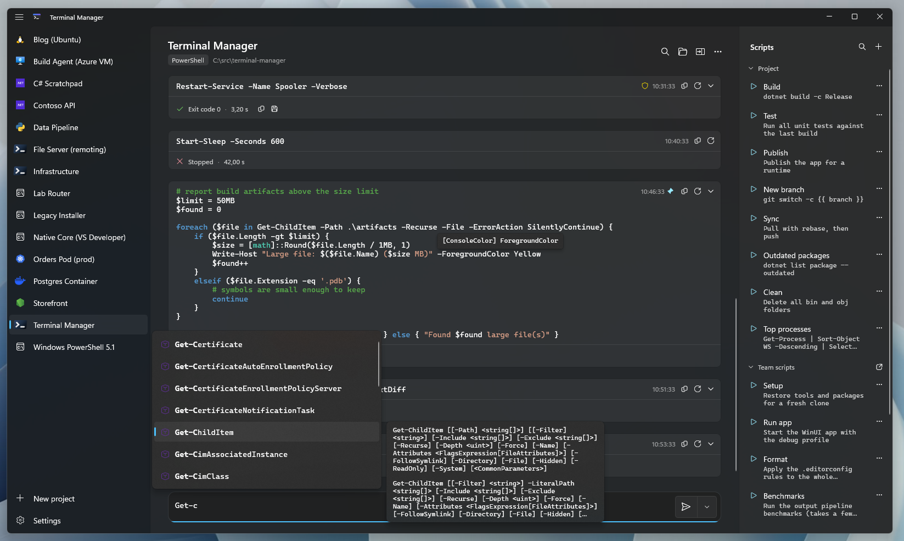

# Terminal Manager

A WinUI 3 app that keeps your terminals organized by project. Every project is a folder with a terminal, a history of what you ran, and the commands you run often, all in one place.



## Features

**Projects**
- One project per folder, each with the terminal it runs in:
  - PowerShell, Windows PowerShell, Developer PowerShell / Command Prompt, cmd
  - `dotnet run`, C# files, Python, Node.js
  - WSL, Docker containers, Kubernetes pods, Azure VMs
  - PowerShell remoting, Telnet
- Environment variables per project, optionally loaded from the `.env` file in the folder
- Prepend and append scripts that wrap every command

**Notebook-style history**
- Each command and its output share a card, with standard error in red, the exit code and the duration
- Rerun, copy, save the output to a file, or pin an entry
- History is kept between sessions, per project
- Search it with match case, regular expressions, or only the matching lines
- Compare the outputs of two runs side by side
- Collapse the output of commands that succeeded and only expand failures

**Editing**
- Syntax highlighting, completion and hover info for PowerShell, with completion for cmd
- Queue commands to run one after another
- Run as administrator through an elevated host, with no need to restart the app

**Scripts**
- Save commands to a project and run them with one click
- Templates with variables, such as `git switch -c {{ branch }}` or `{{ runtime = win-x64 }}` for a default value
- Team scripts from a `.terminal-manager.yml` file kept with your code, reloaded when it changes
- Scripts from `package.json`, run by the package manager of the package

```yaml
scripts:
- name: Release {{ version }}
  description: Tag and push a release
  language: powershell
  command: |
    git tag v{{ version }}
    git push origin v{{ version }}
```

**Everything else**
- Taskbar progress from commands that report it
- Light, dark or system theme, output wrapping and a maximum output height
- Passwords for Telnet projects stay in the Windows Credential Manager, never in the project
- Self-contained and ahead-of-time compiled for fast startup, for x64 and ARM64

## Build

Requires Windows and the .NET 11 SDK.

```powershell
dotnet publish src/App.Client.WinUI3/App.Client.WinUI3.csproj -c Release -r win-x64 --self-contained -p:Platform=x64 -o publish/win-x64
```

The [publish workflow](.github/workflows/publish.yml) builds both architectures and uploads them as artifacts.

## Third-party notices

Logos, icons and dependencies from other projects are listed in [THIRD-PARTY-NOTICES.md](THIRD-PARTY-NOTICES.md).

## Data

Projects, settings and history are stored in `OneDrive\Apps\Terminal`, so they roam between machines, or in `%LocalAppData%\Terminal` without OneDrive. Set the `TERMINAL_DATA_FOLDER` environment variable to use another folder.
